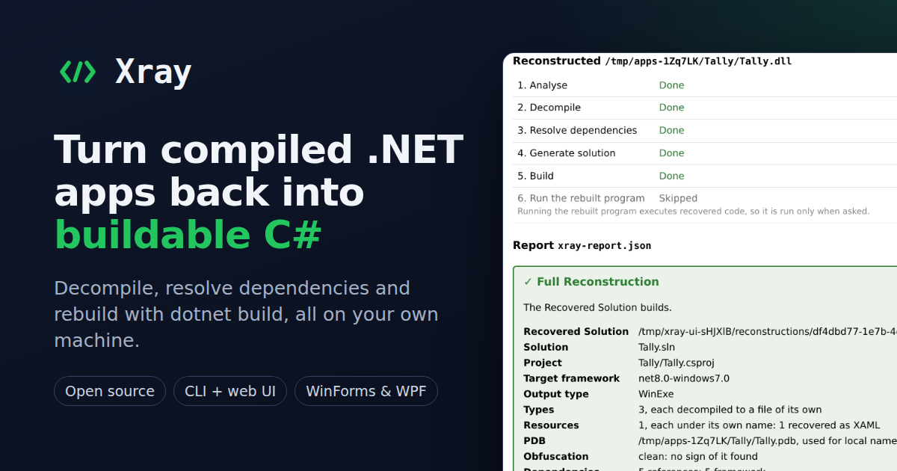
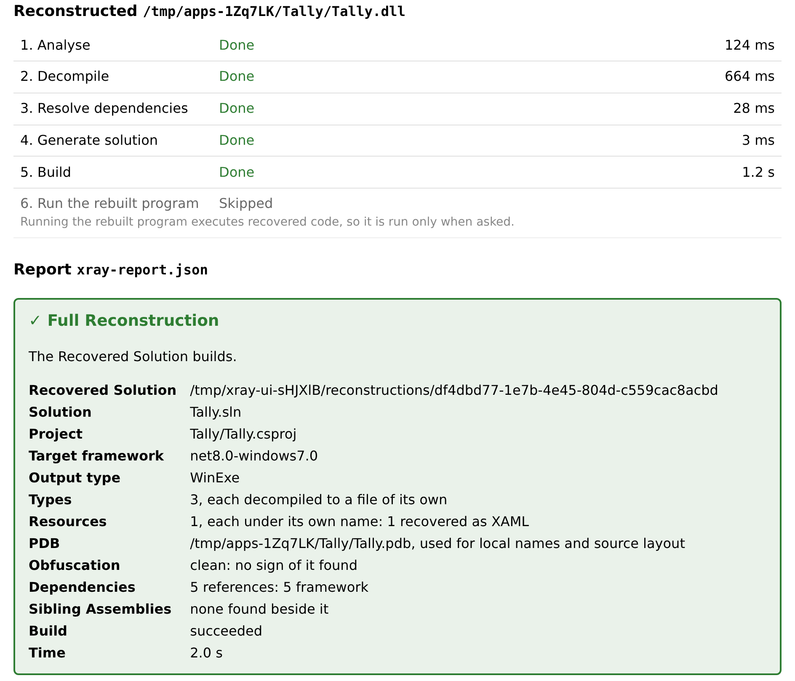
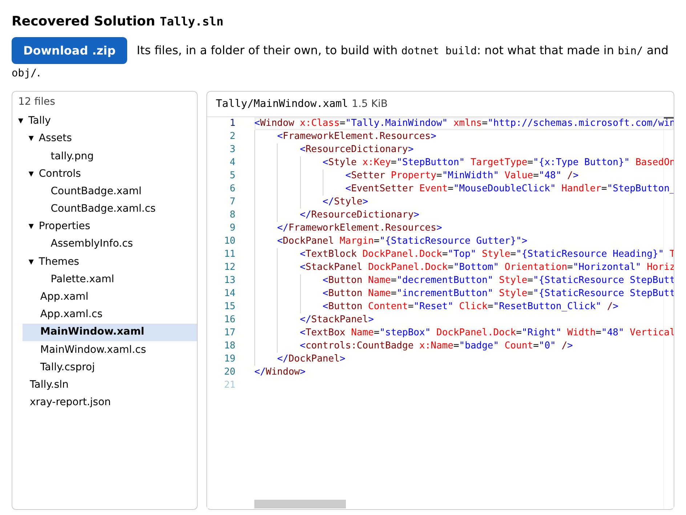
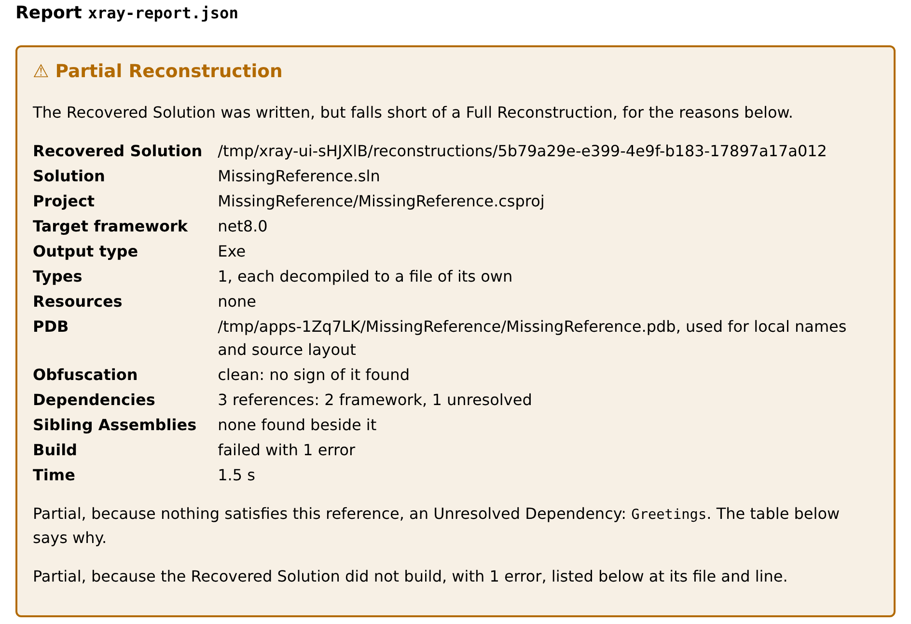

# Xray

Xray turns compiled .NET applications back into **buildable, runnable C# solutions**.

Point it at a .NET `.exe` or `.dll`, or a folder holding an application and its DLLs, and Xray decompiles it, resolves its dependencies, generates an SDK-style Visual Studio solution, and verifies it with `dotnet build`, then shows you the recovered code in your browser and lets you download it as a zip. Where a perfect result isn't possible, it tells you exactly what's missing.

**Project site:** [xray.adrianeyre.co.uk](https://xray.adrianeyre.co.uk/): what Xray is, screenshots of its UI, install instructions and the CLI reference.



## Screenshots

`xray ui` runs the whole pipeline in your browser, on `127.0.0.1`.

**Each stage of the pipeline as it runs, then the report: here, a Full Reconstruction.**



**The Recovered Solution, file by file: here, a window's XAML, recovered from its BAML.**



**A Partial Reconstruction says exactly why: here, an Unresolved Dependency, and the build error it caused.**



[Watch the tour](packages/site/static/images/tour.gif): a WPF app reconstructed in `xray ui`, from its Assembly's path to its recovered XAML and C# (an animated GIF).

## What it does

- **Local web UI**: `xray ui` opens a browser app on `127.0.0.1`. Drag in an Assembly or a folder, or give its path; watch the pipeline run; browse the recovered C# and XAML; see how each dependency was resolved and how the build went; download the Recovered Solution.
- **CLI**: the same engine, for scripting and CI: `xray inspect`, `xray reconstruct`, `xray doctor`.
- **Dependency Resolution**: each reference is satisfied, in order, by the framework, a NuGet package (`PackageReference`), a Sibling Assembly (a project of its own, wired with `ProjectReference`), or a copied binary (`HintPath`); anything else is reported as an Unresolved Dependency.
- **PDBs**: an Assembly's own PDB, beside it, gives back its locals' names and its source files' layout.
- **Resources and UI frameworks**: embedded resources and `.resx`, Windows Forms with its designer's `InitializeComponent`, and WPF, its BAML decompiled back to XAML.
- **Target frameworks**: the original's is kept: .NET Framework 4.0–4.8.1, .NET Core 3.1 and .NET 5+; .NET Framework 2.0/3.5 and `netstandard` on a best-effort basis. Every project is SDK-style, so it builds on Windows, macOS and Linux.
- **Honest reporting**: every Reconstruction writes `xray-report.json` and is classed as a Full Reconstruction (it builds, and with `--run` its program runs) or a Partial Reconstruction, with its Unresolved Dependencies and build errors at their files and lines.

## What it won't do

- **Native Executables** (C, C++, Rust, Go…): detected and rejected; compiled machine code can't be turned back into runnable source.
- **Deobfuscation** or bypassing licence checks or protection: obfuscated input is flagged, and reconstructed as it is, never undone.
- **Hosted service**: Xray runs only on your machine. Nothing you give it is uploaded anywhere; the only network traffic is NuGet package lookups and restores, which `--offline` turns off.

Xray is intended for Assemblies you own or have the right to analyse.

## Requirements

- Windows, macOS or Linux
- Node.js 26 or later, and pnpm 12 or later
- .NET SDK 8 or later

## Install

Xray is published to npm as [`@adrianeyre/xray`](https://www.npmjs.com/package/@adrianeyre/xray):

```bash
pnpm add -g @adrianeyre/xray
xray doctor        # checks Node.js, the .NET SDK and Xray's engine
```

> [!NOTE]
> Until `@adrianeyre/xray` is on npm, `pnpm add -g` fails with a 404: run Xray from source instead.

### Download it

Each [release](https://github.com/adrianeyre/xray/releases/latest) has a download for Windows, macOS and Linux, on x64 and Arm, that runs without Node.js or pnpm installed: unpack it, and run `xray doctor` (`xray.cmd doctor` on Windows) from its folder. It still needs the .NET SDK 8 or later. Its `README.txt` says more.

### From source

With Node.js 26 or later, pnpm 12 or later, Git and a .NET SDK 8 or later on your `PATH`:

```bash
git clone https://github.com/adrianeyre/xray.git
cd xray
pnpm install
pnpm start                # builds the engine, the web UI and the project site, then runs xray ui
pnpm xray doctor          # checks Node.js, the .NET SDK and Xray's engine
pnpm xray --help          # or any other command: pnpm xray <command>
```

On Windows, these run as they are in PowerShell. To get the prerequisites there:

```powershell
winget install OpenJS.NodeJS
winget install Git.Git
winget install Microsoft.DotNet.SDK.8
npm install -g pnpm@12        # in a new terminal, outside the repository
```

Run `npm install -g pnpm` outside the repository: its `devEngines` make npm refuse to run inside it.

## Usage

### The web UI

```bash
xray ui                   # http://127.0.0.1:9729/, opened in your browser
xray ui --port 0          # any free port
```

Drop or choose an Assembly or a folder, or give an Assembly's path to avoid uploading a large application, and follow its Reconstruction stage by stage. Only this machine can reach the server; what you upload, and the Recovered Solutions it writes, are kept in a temporary Workspace deleted when you stop it with Ctrl+C. See [`xray ui`](docs/reference/xray-ui.md).

### Inspect an Assembly

```bash
xray inspect MyApp.dll             # name, version, target framework, references, PDB, obfuscation…
xray inspect MyApp.dll --json      # the same, as JSON for scripts
```

### Reconstruct an application

```bash
xray reconstruct MyApp.exe -o ./out           # decompile, resolve, generate, build
xray reconstruct ./MyApp/ -o ./out            # a folder: its application's Assembly, with its Sibling Assemblies
xray reconstruct MyApp.exe -o ./out --no-build
```

| Option               | What it does                                                                                                                |
| -------------------- | --------------------------------------------------------------------------------------------------------------------------- |
| `-o, --output <dir>` | Where to write the Recovered Solution: a folder that is empty or does not exist yet.                                        |
| `--force`            | Replace whatever the output folder holds.                                                                                   |
| `--no-build`         | Do not run `dotnet build`: the Recovered Solution is written but not verified.                                              |
| `--run`              | Once it builds, run the rebuilt program. This executes recovered code on your machine: use it only on Assemblies you trust. |
| `--no-siblings`      | Do not reconstruct Sibling Assemblies as projects of their own; copy them as binaries instead.                              |
| `--offline`          | Make no network calls: NuGet packages are looked for, and restored, only from the local cache.                              |

It prints a summary of the Reconstruction, and writes `xray-report.json` beside the `.sln`:

```text
Recovered Solution  /home/me/out
Solution            Arithmetic.sln
Project             Arithmetic/Arithmetic.csproj
Target framework    net8.0
Output type         Exe
…
Build               succeeded
Time                1.7 s: analyse 86 ms, decompile 615 ms, resolve dependencies 6 ms, generate 2 ms, build 994 ms
Outcome             Full Reconstruction
Report              xray-report.json
```

```bash
jq -r .outcome ./out/xray-report.json        # full, partial or unverified
```

### Exit codes

| Code | Meaning                                                                                               |
| ---- | ----------------------------------------------------------------------------------------------------- |
| 0    | Success: a Full Reconstruction, or, with `--no-build`, a Recovered Solution written but not verified. |
| 1    | A check failed, or the command could not finish.                                                      |
| 2    | The command line could not be understood.                                                             |
| 3    | Rejected: the input is not a Managed Assembly (a Native Executable, or not a PE file).                |
| 4    | A Partial Reconstruction: `xray-report.json` says why.                                                |

`xray --help` gives every command and option; [`xray reconstruct`](docs/reference/xray-reconstruct.md) says what a Reconstruction does, step by step.

## Documentation

- [Project site](https://xray.adrianeyre.co.uk/): published to GitHub Pages from `main`; see [The project site](docs/processes/project-site.md) for how it is built and deployed
- [Product Requirements Document](docs/product-requirements-document/xray.md): scope, requirements, architecture and roadmap
- [Architectural Decision Records](docs/architectural-decision-record/)
- [Glossary](GLOSSARY.md): the project's vocabulary
- [`xray inspect --json`](docs/reference/xray-inspect-json.md): the schema of the metadata summary
- [`xray reconstruct`](docs/reference/xray-reconstruct.md): what a Reconstruction writes, and its exit codes
- [`xray-report.json`](docs/reference/xray-report-json.md): the schema of the report every Reconstruction writes
- [Progress events](docs/reference/progress-events.md): how a Reconstruction reports each stage as it runs
- [Performance](docs/reference/benchmark.md): the benchmark of a Reconstruction against the 60-second target: what it times, how to run it, and its results
- [Smoke test against a real application](docs/reference/real-app.md): reconstructing AwsWatchman as released, and why it was chosen: what is checked, how to run it, its results, and the gaps it found
- [`xray ui`](docs/reference/xray-ui.md): the local web UI: uploading an Assembly or a folder, reconstructing from a path, where it listens, its Workspace, how it stops, and its API
- [Releasing](docs/processes/releasing.md): what the npm package holds, the commit messages that release a change, and how a version is published
- [Changelog](packages/xray/CHANGELOG.md): what changed in each version of `@adrianeyre/xray`

## Developing

Xray is a pnpm workspace: `packages/core` holds the pipeline, `packages/cli` and `packages/server` are thin adapters over it, `packages/web` is the UI, and `engine/` is the C# sidecar that decompiles (see the [PRD](docs/product-requirements-document/xray.md#9-architecture)). With Node.js 26 or later, pnpm 12 or later and a .NET SDK 8 or later:

```bash
pnpm install
pnpm start                # builds the engine, the web UI and the project site, then runs xray ui
pnpm lint && pnpm typecheck
dotnet test engine
pnpm test                 # unit tests, and a Round-trip of every Fixture
pnpm xray --help          # the CLI, from this checkout
```

Commit messages follow [Conventional Commits](https://www.conventionalcommits.org): merged to `main`, a `fix:` releases a patch version of `@adrianeyre/xray`, a `feat:` a minor one, and a breaking change a major one (see [Releasing](docs/processes/releasing.md)).

## Roadmap

1. **Inspect**: `xray inspect`, `xray doctor`, Native Executable rejection
2. **Console apps + web UI**
3. **Dependencies**: NuGet, multi-assembly apps, PDBs, obfuscation detection
4. **Resources + WinForms**
5. **WPF + v1.0**: BAML → XAML, benchmark, project site on GitHub Pages, release

Phases 1 to 5 make up v1.0. Next:

6. **Future**: native disassembly mode, browser edition (WebAssembly)

## Licence

MIT. Decompilation is powered by [ILSpy](https://github.com/icsharpcode/ILSpy)'s `ICSharpCode.Decompiler` (MIT); see [`THIRD-PARTY-NOTICES.md`](THIRD-PARTY-NOTICES.md).
